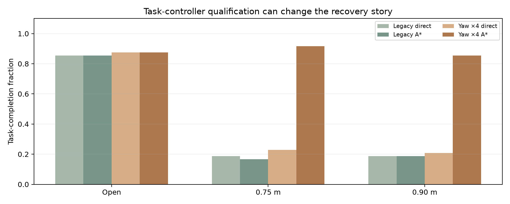

# Baseline qualification and calibration

The early studies used the **legacy task protocol**: AMP yaw gain 1 and stop immediately on entering the 0.25 m arrival zone. Subsequent checks found two baseline confounds. Do not interpret their task-completion rates as intrinsic physical recoverability.

In two command-check seeds, commanding a pure 0.5 rad/s yaw for ten seconds changed heading by only about 0.26 rad (rather than the requested 5 rad). A 2.0 network yaw command produced about 6.86 rad without a fall. This motivated an empirical 4× AMP yaw-command mapping, capped at ±2; it is not a policy retraining result or a claim of accurate yaw tracking across all states. Twenty command-qualification trials retain full traces.

At some waypoint arrivals, stopping at the outer boundary allowed drift to repeatedly break continuous dwell. The optional **centered** arrival mode continues toward an inner radius of 0.10 m while still requiring continuous dwell inside the original 0.25 m acceptance radius. It keeps a 0.20 m/s minimum approach command before heading attenuation. It does not enlarge the acceptance zone, shorten dwell, reset state or skip subgoals.

## Nominal 12-goal endurance, no disturbances

Same 180 s horizon, 0.4 m/s limit, three route rounds and eight seeded initial conditions. These seeds were reused during calibration, so this is development qualification, not independent validation. The original walking controller has a different actuator profile; its result establishes a usable nominal route, not an isolated robustness advantage.

| Controller / protocol | Trials saved | Complete all 12 goals | Falls | Completion time range |
|---|---|---|---|---|
| reference, yaw ×1, legacy arrival | 8/8 | 8/8 | 0/8 | 125.14–125.26 s |
| amp, yaw ×1, legacy arrival | 8/8 | 0/8 | 0/8 | — |
| amp, yaw ×4, legacy arrival | 8/8 | 7/8 | 0/8 | 175.86–178.70 s |
| amp, yaw ×4, centered arrival | 8/8 | 8/8 | 0/8 | 159.54–172.64 s |

## Repeat of the trip design after yaw calibration

144/144 trip runs and 288/288 paired pre-entry probe runs saved. These repeats use yaw ×4 and **legacy arrival**, to isolate yaw mapping from the separate arrival fix. Same seeds/geometry/controller weights/actuator profile/horizons as the original design. Calibration was selected using observed data; these repeats are exploratory, not fresh held-out confirmation. All original results remain saved.

| 13 cm trip contrast | Legacy yaw ×1 | Yaw ×4 |
|---|---|---|
| Seeds 0–7, open | 6/8 | 8/8 |
| Seeds 0–7, 0.90 m | 3/8 | 6/8 |
| Additional seeds 8–19, open | 6/12 | 10/12 |
| Additional seeds 8–19, 0.90 m | 7/12 | 7/12 |

Legacy yaw ×1: 26/61 trials that regained standing after every detected loss still failed task completion. This changes with the task-control protocol; it is not a controller-independent property of the state.

Yaw ×4: 1/37 trials that regained standing after every detected loss still failed task completion. This changes with the task-control protocol; it is not a controller-independent property of the state.

## Does map replanning help once yaw response is improved?

| Width, x=0.8 m | Legacy direct | Legacy A* | Yaw ×4 direct | Yaw ×4 A* |
|---|---|---|---|---|
| Open | 41/48 | 41/48 | 42/48 | 42/48 |
| 0.75 m | 9/48 | 8/48 | 11/48 | 44/48 |
| 0.9 m | 9/48 | 9/48 | 10/48 | 41/48 |

Within yaw ×4, paired A* minus direct completion (95% parent-seed bootstrap intervals):

- 0.75 m: +68.8%, interval [+56.2%, +79.2%]; 8 complete parent-seed clusters.
- 0.90 m: +64.6%, interval [+52.1%, +77.1%]; 8 complete parent-seed clusters.

Largest direct/A* qpos difference through the 0.40 s intervention boundary: **0** across 144 matched pairs. 0/288 calibrated pre-entry branches crossed balance-loss thresholds.

Each complete cell has 48 branches, but only eight parent seeds, each tested under six force cases. Treat the counts as descriptive. A* uses a known map and can detour around the finite barriers. The yaw mapping is active from branch initialization; A* activates after the force pulse at 0.4 s. State-matched direct/A* comparisons within the new mapping should be interpreted separately from cross-mapping comparisons.

[Calibrated trip CSV](data/calibrated_trip.csv) · [Calibrated probes CSV](data/calibrated_probes.csv) · [Nominal endurance CSV](data/nominal_endurance.csv).
