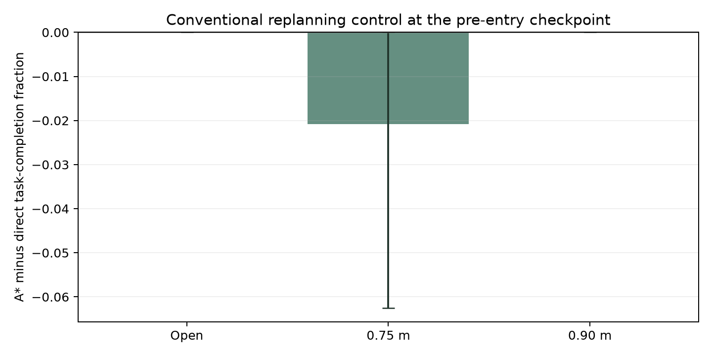
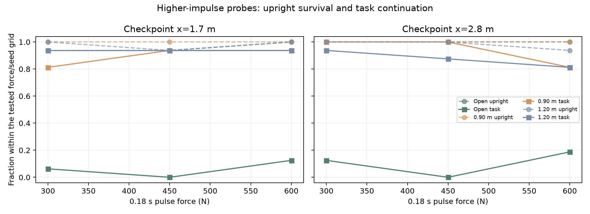

# State-matched follow-up analysis

Initial push grid: 768/768 branches saved; 0 initial penetrations flagged. The 80/140/200 N pulses last 0.18 s (14.4/25.2/36 Ns). **0 balance losses occurred.** Consequently, failures here do not demonstrate failure to regain upright balance. Eight parent seeds are reused across all six force cases and corridor widths.

The restore qualification reproduced ten unperturbed policy steps with exactly zero qpos difference. This checks the implemented checkpoint mechanism at one checkpoint, not a proof for arbitrary dynamics or every state. Different checkpoint positions also have different remaining task distances and gait phases, so their raw success fractions do not isolate a causal effect of progress. Within-checkpoint width comparisons are the cleaner contrast.

## A conventional navigation control

The A* baseline has a perfect static map, 0.10 m grid, 0.23 m planar inflation and replans every 0.4 simulated seconds. It activates at 0.4 s, after the 0.20–0.38 s pulse. The low-level AMP controller, target, speed limit, parent state, pulse and 30 s branch horizon remain fixed. It may go around the end of the barrier. It has no learned reserve model, contact planner or guarantees.

144/144 planned matched planner comparisons saved. Largest pre-intervention qpos difference through t=0.40 s: **0** (mixed metres/radians).

| Width | Direct completion | A* completion | Seed-mean difference | Seed bootstrap 95% interval |
|---|---|---|---|---|
| Open | 41/48 | 41/48 | +0.0% | [+0.0%, +0.0%] |
| 0.75 m | 9/48 | 8/48 | -2.1% | [-6.2%, +0.0%] |
| 0.9 m | 9/48 | 9/48 | +0.0% | [+0.0%, +0.0%] |

Intervals resample the eight parent seeds, retaining their six paired force cases together (10,000 deterministic bootstrap draws). They describe sensitivity to the small seeded initial jitter in this simulator; they are not calibrated deployment bounds. With only eight parents and an exploratory control, do not treat branch counts as independent replications.

Across the matched rows, completion changes from 59/144 to 58/144. This particular basic planner did not improve aggregate completion. That does not eliminate navigation as a mechanism: a planar, forward-only steering controller can still stall near contacts. We cannot classify the remaining failures as physical unrecoverability.

## Stronger-impulse physical recovery probes

288/288 planned branches saved. This follow-up was selected **after** the first grid produced no falls. Pulses are 300/450/600 N for 0.18 s (54/81/108 Ns), at x=1.7 or 2.8 m. These are exploratory simulated impacts; no claim is made about their real-world frequency. Widths are open/0.90/1.20 m, with the same eight parent seeds and fixed direct follower. Initial penetrations are excluded.

| Checkpoint | Width | Task completion | Balance loss | All loss episodes regained standing | Standing without completing task* |
|---|---|---|---|---|---|
| 1.7 m | Open | 3/48 | 39/48 | 37/39 | 35/37 |
| 1.7 m | 0.9 m | 43/48 | 0/48 | 0/0 | 0/0 |
| 1.7 m | 1.2 m | 45/48 | 1/48 | 0/1 | 0/0 |
| 2.8 m | Open | 5/48 | 40/48 | 40/40 | 37/40 |
| 2.8 m | 0.9 m | 45/48 | 0/48 | 0/0 | 0/0 |
| 2.8 m | 1.2 m | 42/48 | 2/48 | 1/2 | 1/1 |

*Denominator is trials in which every detected loss episode regained standing. Physical stabilization, task continuation and simulator contact force are separate observations. A wall can supply support as well as restrict movement; geometric free space need not have a monotonic relationship with controller-specific recovery.

Dashed “upright” means either no balance loss or all detected loss episodes recovered. It does not require task completion. Each force/width/position cell contains 16 branches from eight parents and two directions; those two directions are not independent seeds.

## Download the trial-level tables

[Initial push probes CSV](data/push_probes.csv) · [Map-replanning CSV](data/map_replanning.csv) · [Higher-impulse CSV](data/higher_impulse_probes.csv). Raw run paths are on Thor; each includes inputs, state trace, telemetry, event log, plots and interpretation.
