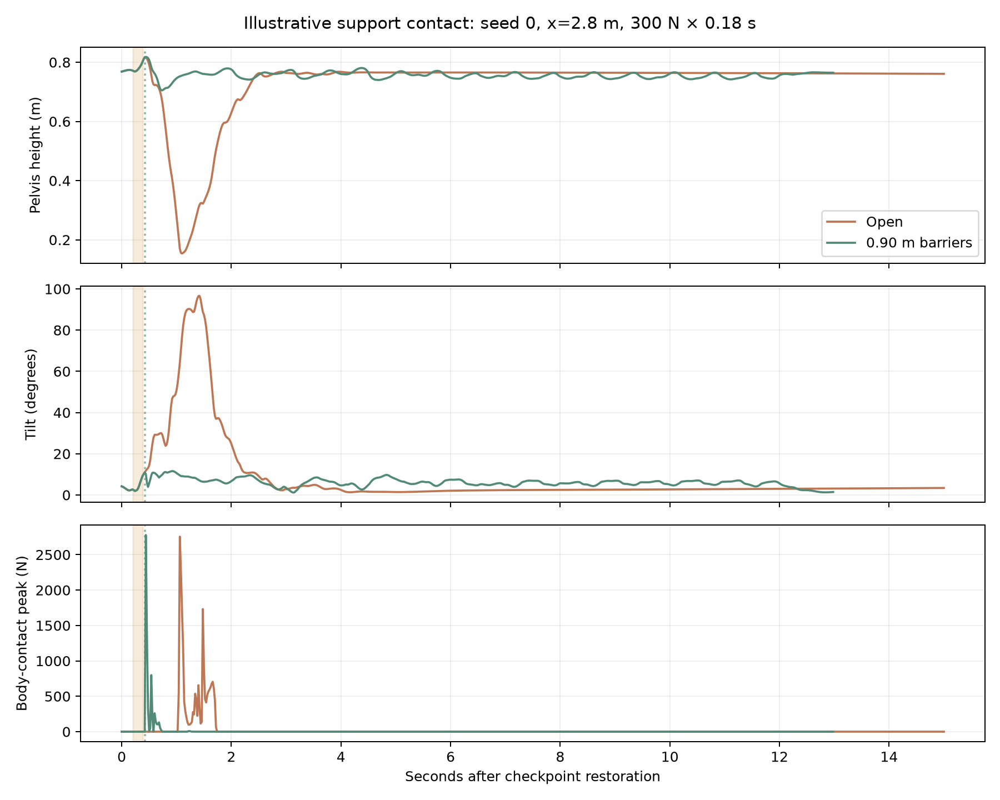

# Contact support mechanism check

This analysis is specific to the stronger-impulse experiment. The 1.10 m-high fixed barriers can physically intercept the robot. They are rigid fixtures, not compliant human-safe supports; lower fall rates can coexist with undesirable impacts. Contact-force peaks depend on the simulator/contact model and are not injury predictions.

| Checkpoint | Width | Trials | Barrier body-contact trials | Barrier head-contact trials | Median peak non-foot body force (N) | Maximum peak head force (N) |
|---|---|---|---|---|---|---|
| 1.7 m | Open | 48 | 0 | 0 | 2560.3 | 6340.1 |
| 1.7 m | 0.9 m | 48 | 48 | 0 | 4482.8 | 0.0 |
| 1.7 m | 1.2 m | 48 | 48 | 11 | 5548.3 | 2574.0 |
| 2.8 m | Open | 48 | 0 | 0 | 3054.6 | 5862.9 |
| 2.8 m | 0.9 m | 48 | 48 | 0 | 4245.7 | 0.0 |
| 2.8 m | 1.2 m | 48 | 48 | 15 | 5143.2 | 3722.6 |

The orange band is the force pulse; dotted line is the first measured barrier-body contact. This pair was deliberately selected to illustrate an open-space fall and a constrained-space completion at the same parent state and force. It is not an independent replication or representative effect estimate; aggregate results take precedence. The contact check supports a physical-support explanation, without proving an intentional bracing skill.
