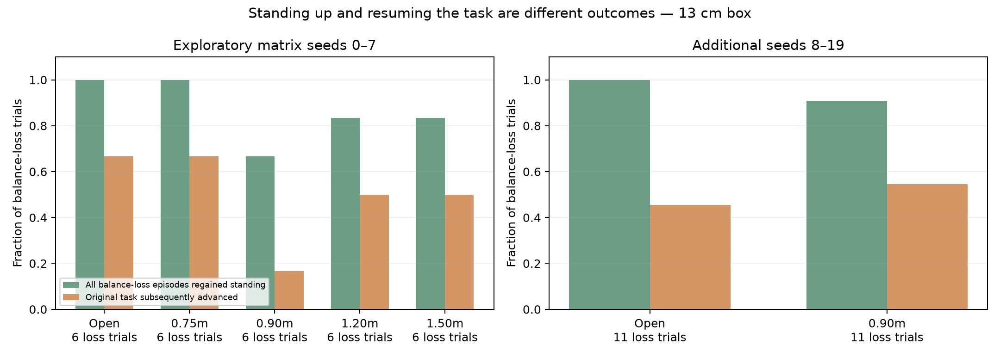
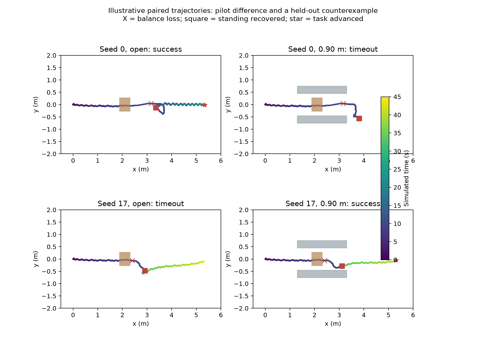

# Interpretation of the completed 144-trial trip study

## Three results worth keeping

1. **Nominal feasibility was established:** all 40 box-free corridor executions succeeded, using eight initial-condition seeds reused across five widths. These are not 40 independent seeds.
2. **Standing is an incomplete success metric:** 26/61 trials in which all detected balance-loss episodes regained standing still failed to complete the task segment. This is descriptive across related conditions, not a population-wide failure probability.
3. **The simple clearance hypothesis did not hold reliably:** the pilot/matrix advantage at 0.90 m did not repeat in the additional seeds. Matrix seeds: open 6/8 versus corridor 3/8, exploratory exact paired p=0.25. Additional seeds: open 6/12 versus corridor 7/12, paired p=1.0. This is not evidence of equivalence, but it is insufficient evidence for a reliable wider-is-better claim.

## Why it matters

The research objective should explicitly require task resumption, not just standing after a fall. However, preserving empty space or counting nominal recovery behaviors is too crude: contacts, landing orientation, obstacle passage and controller quirks can change the outcome in either direction. A support surface may help recovery while a barrier may trap the task controller.

This strengthens the motivation for measuring **task-conditioned recovery capability**, but it does not establish a new algorithm or demonstrate preservation learning. The present controller has one unified recovery policy, not an independently selectable portfolio of recovery strategies.

## Mechanism and initial-state check

| Seed | Max pre-box-contact qpos difference (mixed m/rad) | First barrier contact |
|---|---|---|
| 0 | 0 | 9.422 s |
| 1 | 0 | 9.258 s |
| 2 | 0 | 9.478 s |
| 3 | 0 | 9.348 s |
| 4 | 0 | None s |
| 5 | 0 | None s |
| 6 | 0 | 9.448 s |
| 7 | 0 | 9.342 s |

The check compares open and 0.90 m trajectories before the earliest measured trip-box contact. Differences can reveal earlier barrier interactions or numerical/contact sensitivity; they must not be ignored when attributing the outcome to post-fall space alone. The next counterfactual study restores an identical physics/controller checkpoint to remove approach-trajectory differences.

The selected seeds are illustrations, not representative success estimates. Seed 17 is deliberately shown as a counterexample to the pilot story. Aggregate counts above take precedence over videos.
