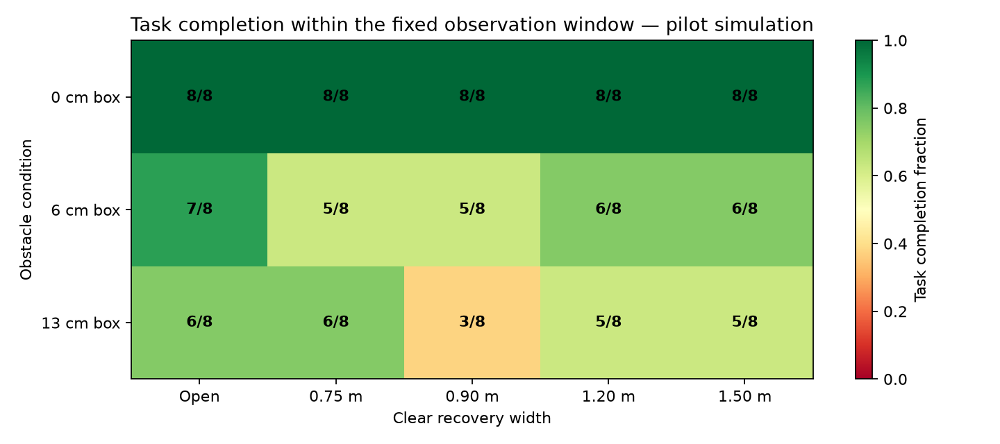
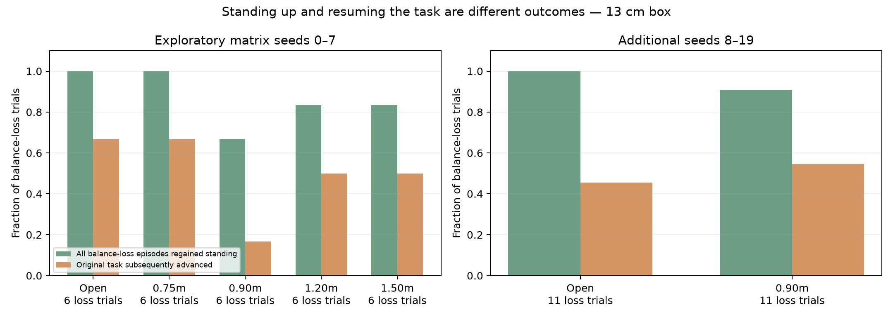
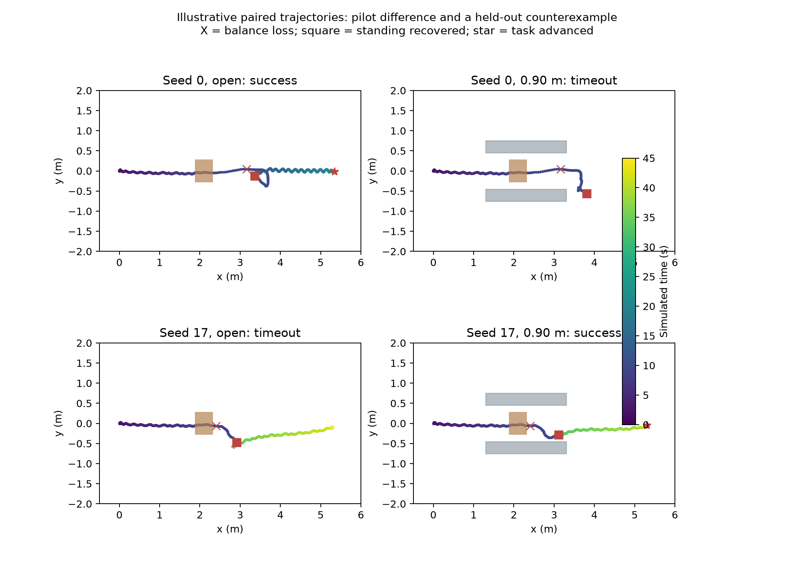
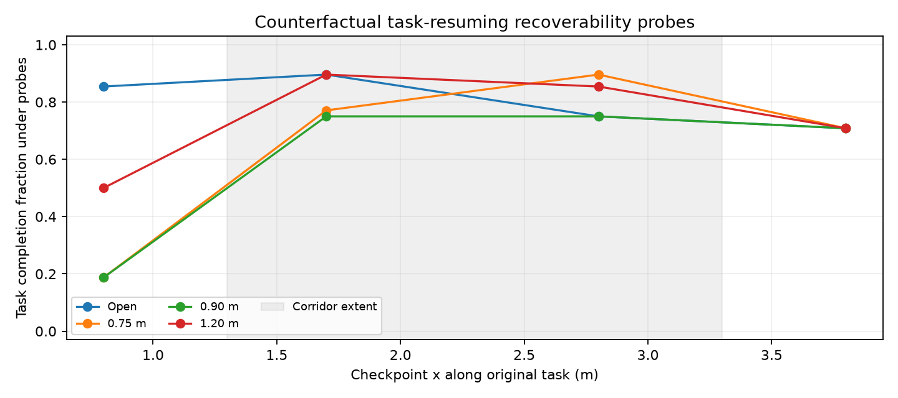
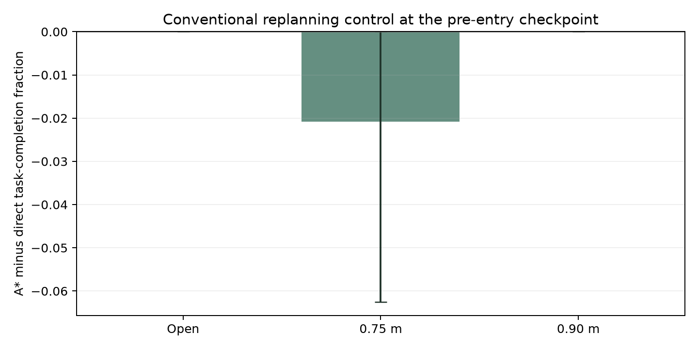
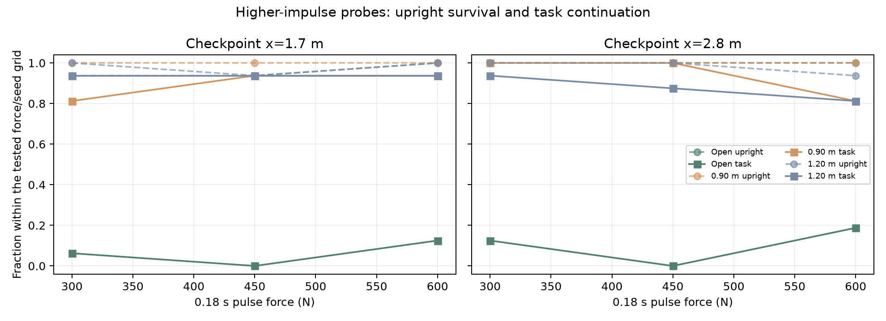
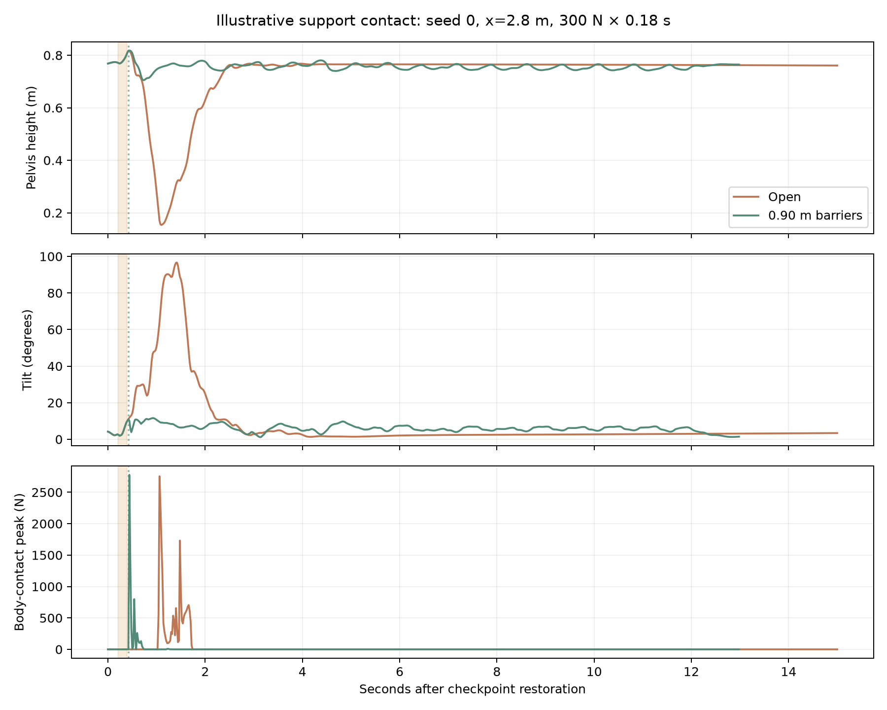
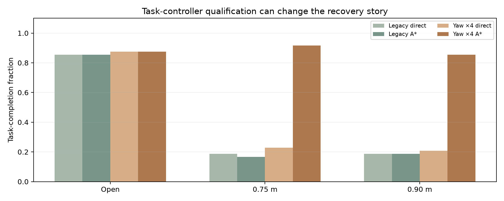

# Beyond Recovery — wake-up report

Saved: 2026-11-14T22:13:21+00:00 UTC. **All planned studies below completed.**

## Start here

Open **[the live lab](http://localhost:8080)** and refresh once. Use **AMP walk + get-up**, **Turn + arrival tuning**, and begin with **Flat hazard-course control** or **Long-horizon endurance**. Then try **Trip box — open space**, **Trip box — constrained space**, **Rough pavement** and **Low overhead beam**. Scene descriptions state the question and the physical hazard. The viewer is live; the recordings embedded below are explicitly saved traces.

The viewport now occupies 72% of browser height and has fullscreen/focus controls. Start, pause, stop/save and push controls are over the scene. Physics and inference stay on Thor; the browser renders locally. A fall no longer freezes physics: the learned controller gets up physically and resumes the route. Every live trial saves video, telemetry, state trace, contact events, plots and written interpretation on Thor. No VLA is used.

## What we learned

1. **The baseline needed fixing before making research claims.** The AMP model barely turned in place at the old yaw command. Some waypoint arrivals also stalled at the edge of the dwell region. Empirical yaw mapping and a centering approach completed the 12-goal, three-round route in **8/8 development seeds**, without falls. This is baseline engineering, not a new recovery algorithm. The legacy protocol remains selectable and all earlier results remain saved.
2. **Physical get-up works, and task resumption can be observed live.** The tuned live validation fell at **8.98 s**, recovered sustained standing at **11.62 s**, and advanced the original subgoal at **21.18 s**, with no execution-time state reset. Qualification also tested settled back, side and front falls. This does not mean every fall is recoverable.
3. **The initial “more room is better” story did not replicate reliably.** With the legacy protocol and 13 cm box, matrix seeds gave open **6/8** versus 0.90 m **3/8** completion; additional seeds gave **6/12 versus 7/12**. Do not use the pilot video as a novelty claim. The later calibrated repeat is reported separately below.
4. **Most of the initial standing-versus-task gap disappeared after a baseline fix.** In the legacy trip study, **26/61** trials that regained standing after every loss still failed completion. With yaw ×4 in the full repeated 144-trial design, that count is **1/37**. The set of trials that fell also changed, so these fractions are not a matched causal decomposition. They nevertheless show that the original gap was strongly protocol-dependent; it cannot establish a new preservation-learning problem by itself.
5. **Useful contact can outweigh empty space.** In the stronger-impulse grid, open space had **79/96** balance-loss trials; 0.90 m barriers had **0/96**. Every constrained trial in that latter group physically contacted a barrier with the body. This supports a contact-support explanation, not proof of an intelligent bracing strategy. Barrier contacts can be severe; the force table below exposes that cost rather than equating “did not fall” with safe success.
6. **Task failure is not proof of physical unrecoverability.** All **768** initial 80/140/200 N branches remained above our balance-loss thresholds, yet many did not finish. The first map planner alone changed completion from **59/144 to 58/144**. After correcting yaw response, conventional A* raises 0.75 m entrance completion from **11/48 to 44/48**, and 0.90 m completion from **10/48 to 41/48**, using the same parent states and force cases. The turning/planning interaction explains much of this apparent failure mode. These 48 cases reuse eight parent seeds; they are not 48 independent robots or environments.

## Research decision

**Go on the lab; no-go on using these initial failures as a new algorithm claim.** Freeze the corrected baseline, establish a residual problem beyond ordinary planning/control, then develop a task-conditioned continuation metric. Measure task progress, physical stabilization, task resumption and prohibited-contact outcomes separately. Preserve access to useful support as well as stepping space.

**Do not yet claim:** a learned recovery-preservation algorithm, multiple independently selectable recovery strategies, calibrated uncertainty bounds, a new literature gap, physical impossibility from a failed policy, or hardware validation. The system currently has one unified AMP walk/get-up policy and a conventional optional map planner. The experiments are exploratory simulation development on a limited disturbance family.

The next defensible step is to freeze the corrected task protocol, collect fresh task/controller-state branches, validate a continuation estimator on new seeds and dynamics, and compare actions that preserve that estimate against task-only control and conventional planning. [Research formulation](data/RESEARCH_FORMULATION.md).

## Experiment inventory

| Study | Saved trials | Planned |
|---|---|---|
| Legacy trip / clearance | 144 | 144 |
| State-matched initial pushes | 768 | 768 |
| Legacy-map replanning control | 144 | 144 |
| Stronger-impulse physical recovery | 288 | 288 |
| Nominal endurance qualification | 32 | 32 |
| Post-yaw-calibration repeats | 432 | 432 |

**1808 saved research trials** in this inventory, plus twenty command-tracking qualifications and live/integration checks. These are not independent statistical samples: most studies reuse eight parent seeds and paired disturbance cases.

## Inspect the recordings

These videos render saved qpos traces at 25 fps. Support barriers are shown translucent for visibility; collision physics is unchanged. They do not rerun physics or stand in for the live app. Examples were selected for explanation; aggregate results take precedence. The trip examples use the legacy protocol and illustrate both a pilot difference and a held-out counterexample.

### Trip: seed 0, open space
<video controls preload="none" src="clips/trip-seed0-open.mp4"></video>

### Same seed and box, 0.90 m space
<video controls preload="none" src="clips/trip-seed0-narrow.mp4"></video>

### Counterexample: seed 17, open space
<video controls preload="none" src="clips/trip-seed17-open.mp4"></video>

### Same held-out seed, 0.90 m space
<video controls preload="none" src="clips/trip-seed17-narrow.mp4"></video>

### Same initial state and 300 N lateral pulse: open space
<video controls preload="none" src="clips/support-open.mp4"></video>

### Same pulse, with physical support barriers
<video controls preload="none" src="clips/support-narrow.mp4"></video>

## Practical limits and verification

Physics is native MuJoCo at 2 ms, policy control at 20 ms. Browser geometry is simplified for rendering only; physics collision geometry is retained. The robot has idealized actuators, rigid static fixtures and no payload task or real hardware. The AMP and original walking controllers use different published actuator profiles, so the clean research comparisons are within one profile. Apparent impacts are simulator force proxies, not injury estimates.

The targeted project suite has 16 passing tests. Frontend bundling and JavaScript syntax checks pass. HTTP/WebSocket integration checks exercised real physics, pause/step, manual control, pushes and recording; a 0 s immediate stop still saves its artifacts. The tuned live get-up/resumption check passed. Automated browser interaction was unavailable because no browser surface was connected; interactive layout/camera comfort still needs your feedback.

Reports were checkpointed before and during long jobs and are stored on both Thor and the workstation at completion. The browser report supports printing to PDF. Trial-level CSV downloads and detailed figures are below; raw state/action logs and source snapshots remain on Thor under `/home/saidevdhal/beyond-recovery/artifacts/research/`. Source sync excludes generated report assets, preventing stale local copies from overwriting results.

## Detailed legacy-protocol trip experiment

Record audit: **1837/1837** research records passed artifact, finite-state, time and log-count checks. [Audit details](data/record_audit.json). A legacy live/accelerated metadata flag was corrected with an explicit audit trail; physics data were unchanged.

Record audit: **1837/1837** research records passed artifact, finite-state, time and log-count checks. [Audit details](data/record_audit.json). A legacy live/accelerated metadata flag was corrected with an explicit audit trail; physics data were unchanged.

Record audit: **1837/1837** research records passed artifact, finite-state, time and log-count checks. [Audit details](data/record_audit.json). A legacy live/accelerated metadata flag was corrected with an explicit audit trail; physics data were unchanged.

## What is being tested

One fixed AMP controller and actuator profile; speed 0.4 m/s; identical target at x=5.5 m; identical 45 s nominal task horizon. A trip box is at x=2.1 m. Only box height, surrounding clear width and seeded initial x/y/yaw offsets change. Initial variation is ±1.5 cm and ±0.015 rad. There are no injected pushes, no retraining, no operator input and no state resets during a trial. Post-fall observation can extend the horizon by up to 20 s so impact and recovery are not cut off.

The matrix uses 0, 6 and 13 cm obstacles, open/0.75/0.90/1.20/1.50 m widths and seeds 0–7. Box-free corridor controls test nominal feasibility. Additional seeds 8–19 compare open and 0.90 m width at 13 cm height. The latter seeds were not in the pilot. The contrast itself was chosen after the pilot, so the study remains exploratory.

## Completed legacy matrix results

| Box | Clear width | Task success (95% Wilson interval) | Balance loss | Upright recovered* | Task resumed after loss* |
|---|---|---|---|---|---|
| 0 cm | Open | 8/8 (68%–100%) | 0/8 | 0/0 | 0/0 |
| 0 cm | 0.75 m | 8/8 (68%–100%) | 0/8 | 0/0 | 0/0 |
| 0 cm | 0.90 m | 8/8 (68%–100%) | 0/8 | 0/0 | 0/0 |
| 0 cm | 1.20 m | 8/8 (68%–100%) | 0/8 | 0/0 | 0/0 |
| 0 cm | 1.50 m | 8/8 (68%–100%) | 0/8 | 0/0 | 0/0 |
| 6 cm | Open | 7/8 (53%–98%) | 3/8 | 3/3 | 2/3 |
| 6 cm | 0.75 m | 5/8 (31%–86%) | 2/8 | 1/2 | 1/2 |
| 6 cm | 0.90 m | 5/8 (31%–86%) | 4/8 | 4/4 | 2/4 |
| 6 cm | 1.20 m | 6/8 (41%–93%) | 3/8 | 3/3 | 2/3 |
| 6 cm | 1.50 m | 6/8 (41%–93%) | 3/8 | 3/3 | 2/3 |
| 13 cm | Open | 6/8 (41%–93%) | 6/8 | 6/6 | 4/6 |
| 13 cm | 0.75 m | 6/8 (41%–93%) | 6/8 | 6/6 | 4/6 |
| 13 cm | 0.90 m | 3/8 (14%–69%) | 6/8 | 4/6 | 1/6 |
| 13 cm | 1.20 m | 5/8 (31%–86%) | 6/8 | 5/6 | 3/6 |
| 13 cm | 1.50 m | 5/8 (31%–86%) | 6/8 | 5/6 | 3/6 |

*Recovery columns use balance-loss trials as their denominator. Upright recovery requires height >0.65 m, tilt <25° and bounded angular speed for one continuous second. It is separate from subsequent task advancement.

## Matched primary contrast: 13 cm box, open vs 0.90 m

- matrix: 8 paired seeds; open succeeds 6/8, constrained 3/8. Discordant pairs: 3 favor open, 0 favor constrained. Exploratory exact paired p=0.25.
- holdout: 12 paired seeds; open succeeds 6/12, constrained 7/12. Discordant pairs: 1 favor open, 2 favor constrained. Exploratory exact paired p=1.

## Why this could matter — and what it does not establish

The pilot showed that both open and constrained cases could stand up, while only the open case advanced the original task within 35 s. This motivates **task-resuming recoverability**, rather than standing up as the sole recovery metric.

A width effect is relevant to the proposed problem only after checking that the corresponding box-free corridor is feasible. A failure can also arise from the walking controller's obstacle-passage or local route-following limitations. It does not prove that every possible recovery action was physically unavailable. Multiple strategies, calibrated uncertainty, preservation learning and physical validation remain future work.

The paired p-values concern these particular simulation initial conditions. Small samples, an exploratory contrast, many inspected cells and the limited disturbance domain prevent broad claims of significance, safety or novelty. Trajectory-mechanism checks and selected recordings appear in this report.

## Other physically observed tests

- Uneven paving: 15 measured hazard contacts, one subgoal advanced, no balance loss in a 35 s qualification.
- Overhead beam: a measured head contact-force proxy of about 178.7 N; no task subgoal advanced in 35 s. This primarily exposes clearance/ducking/avoidance competence, not a demonstrated loss of all recovery options. Contact force is not an injury estimate.
- Live control checks: actual state changes, frozen pause time, an exact 20 ms step, physical pushes, manual driving, WebSockets and automatic saves passed. An immediate 0.00 s stop still saves a video, figures and traces. The initial twelve targeted checks passed; the final project suite contains sixteen passing tests.

## Artifacts and reproduction

- Experiment root on Thor: `/home/saidevdhal/beyond-recovery/artifacts/research/matched-20261115-025833`. Every trial saves state/action/force telemetry, contacts/events, figures, analysis, configuration and metrics. Matrix trials use accelerated native physics without live pacing; videos for selected contrasts will be rendered from saved states and labeled accordingly. The interactive live console continues recording videos automatically.
- `results.jsonl` is append-only progress; `results.json` is the current complete result set; `experiment.json` records the plan; `source_snapshot.zip` preserves the code/configuration used at launch.
- The baseline and AMP profiles have different published actuator settings. This study compares widths within AMP, not controller-to-controller robustness.
- The live app exposes current-state visualization, not these accelerated recordings.

## Completed trip-study interpretation

## Three results worth keeping

1. **Nominal feasibility was established:** all 40 box-free corridor executions succeeded, using eight initial-condition seeds reused across five widths. These are not 40 independent seeds.
2. **Standing is an incomplete success metric:** 26/61 trials in which all detected balance-loss episodes regained standing still failed to complete the task segment. This is descriptive across related conditions, not a population-wide failure probability.
3. **The simple clearance hypothesis did not hold reliably:** the pilot/matrix advantage at 0.90 m did not repeat in the additional seeds. Matrix seeds: open 6/8 versus corridor 3/8, exploratory exact paired p=0.25. Additional seeds: open 6/12 versus corridor 7/12, paired p=1.0. This is not evidence of equivalence, but it is insufficient evidence for a reliable wider-is-better claim.

## Why it matters

The research objective should explicitly require task resumption, not just standing after a fall. However, preserving empty space or counting nominal recovery behaviors is too crude: contacts, landing orientation, obstacle passage and controller quirks can change the outcome in either direction. A support surface may help recovery while a barrier may trap the task controller.

This strengthens the motivation for measuring **task-conditioned recovery capability**, but it does not establish a new algorithm or demonstrate preservation learning. The present controller has one unified recovery policy, not an independently selectable portfolio of recovery strategies.

## Mechanism and initial-state check

| Seed | Max pre-box-contact qpos difference (mixed m/rad) | First barrier contact |
|---|---|---|
| 0 | 0 | 9.422 s |
| 1 | 0 | 9.258 s |
| 2 | 0 | 9.478 s |
| 3 | 0 | 9.348 s |
| 4 | 0 | None s |
| 5 | 0 | None s |
| 6 | 0 | 9.448 s |
| 7 | 0 | 9.342 s |

The check compares open and 0.90 m trajectories before the earliest measured trip-box contact. Differences can reveal earlier barrier interactions or numerical/contact sensitivity; they must not be ignored when attributing the outcome to post-fall space alone. The next counterfactual study restores an identical physics/controller checkpoint to remove approach-trajectory differences.

The selected seeds are illustrations, not representative success estimates. Seed 17 is deliberately shown as a counterexample to the pilot story. Aggregate counts above take precedence over videos.

## Further stage: state-matched counterfactual probes

Progress: 768/768 branches saved. Each branch restores the same physics integration state and four-frame controller history, then applies a 0.18 s lateral force pulse after 0.20 s. Forces are 80, 140 or 200 N in either lateral direction. Corridor width is changed without changing the robot/controller. There is no trip box in this experiment.

Checkpoints are before, within and beyond the constrained region. This controls the gait/pose differences that otherwise confound comparing different routes. Restoration is an offline experiment initialization, never an execution-time recovery action. Initial barrier penetrations beyond 1 mm are flagged and excluded from the displayed estimates.

| Checkpoint x | Clear width | Completion | Balance-loss trials | All loss episodes recovered |
|---|---|---|---|---|
| 0.8 m | Open | 41/48 | 0/48 | 0/0 |
| 0.8 m | 0.75 m | 9/48 | 0/48 | 0/0 |
| 0.8 m | 0.9 m | 9/48 | 0/48 | 0/0 |
| 0.8 m | 1.2 m | 24/48 | 0/48 | 0/0 |
| 1.7 m | Open | 43/48 | 0/48 | 0/0 |
| 1.7 m | 0.75 m | 37/48 | 0/48 | 0/0 |
| 1.7 m | 0.9 m | 36/48 | 0/48 | 0/0 |
| 1.7 m | 1.2 m | 43/48 | 0/48 | 0/0 |
| 2.8 m | Open | 36/48 | 0/48 | 0/0 |
| 2.8 m | 0.75 m | 43/48 | 0/48 | 0/0 |
| 2.8 m | 0.9 m | 36/48 | 0/48 | 0/0 |
| 2.8 m | 1.2 m | 41/48 | 0/48 | 0/0 |
| 3.8 m | Open | 34/48 | 0/48 | 0/0 |
| 3.8 m | 0.75 m | 34/48 | 0/48 | 0/0 |
| 3.8 m | 0.9 m | 34/48 | 0/48 | 0/0 |
| 3.8 m | 1.2 m | 34/48 | 0/48 | 0/0 |

The six force conditions for one seed share a parent state. They are not independent seed replications. These are empirical estimates for one fixed controller over a finite force grid, not a viability guarantee or a calibrated lower bound for unseen dynamics.

## Deeper probe interpretation

Initial push grid: 768/768 branches saved; 0 initial penetrations flagged. The 80/140/200 N pulses last 0.18 s (14.4/25.2/36 Ns). **0 balance losses occurred.** Consequently, failures here do not demonstrate failure to regain upright balance. Eight parent seeds are reused across all six force cases and corridor widths.

The restore qualification reproduced ten unperturbed policy steps with exactly zero qpos difference. This checks the implemented checkpoint mechanism at one checkpoint, not a proof for arbitrary dynamics or every state. Different checkpoint positions also have different remaining task distances and gait phases, so their raw success fractions do not isolate a causal effect of progress. Within-checkpoint width comparisons are the cleaner contrast.

## A conventional navigation control

The A* baseline has a perfect static map, 0.10 m grid, 0.23 m planar inflation and replans every 0.4 simulated seconds. It activates at 0.4 s, after the 0.20–0.38 s pulse. The low-level AMP controller, target, speed limit, parent state, pulse and 30 s branch horizon remain fixed. It may go around the end of the barrier. It has no learned reserve model, contact planner or guarantees.

144/144 planned matched planner comparisons saved. Largest pre-intervention qpos difference through t=0.40 s: **0** (mixed metres/radians).

| Width | Direct completion | A* completion | Seed-mean difference | Seed bootstrap 95% interval |
|---|---|---|---|---|
| Open | 41/48 | 41/48 | +0.0% | [+0.0%, +0.0%] |
| 0.75 m | 9/48 | 8/48 | -2.1% | [-6.2%, +0.0%] |
| 0.9 m | 9/48 | 9/48 | +0.0% | [+0.0%, +0.0%] |

Intervals resample the eight parent seeds, retaining their six paired force cases together (10,000 deterministic bootstrap draws). They describe sensitivity to the small seeded initial jitter in this simulator; they are not calibrated deployment bounds. With only eight parents and an exploratory control, do not treat branch counts as independent replications.

Across the matched rows, completion changes from 59/144 to 58/144. This particular basic planner did not improve aggregate completion. That does not eliminate navigation as a mechanism: a planar, forward-only steering controller can still stall near contacts. We cannot classify the remaining failures as physical unrecoverability.

## Stronger-impulse physical recovery probes

288/288 planned branches saved. This follow-up was selected **after** the first grid produced no falls. Pulses are 300/450/600 N for 0.18 s (54/81/108 Ns), at x=1.7 or 2.8 m. These are exploratory simulated impacts; no claim is made about their real-world frequency. Widths are open/0.90/1.20 m, with the same eight parent seeds and fixed direct follower. Initial penetrations are excluded.

| Checkpoint | Width | Task completion | Balance loss | All loss episodes regained standing | Standing without completing task* |
|---|---|---|---|---|---|
| 1.7 m | Open | 3/48 | 39/48 | 37/39 | 35/37 |
| 1.7 m | 0.9 m | 43/48 | 0/48 | 0/0 | 0/0 |
| 1.7 m | 1.2 m | 45/48 | 1/48 | 0/1 | 0/0 |
| 2.8 m | Open | 5/48 | 40/48 | 40/40 | 37/40 |
| 2.8 m | 0.9 m | 45/48 | 0/48 | 0/0 | 0/0 |
| 2.8 m | 1.2 m | 42/48 | 2/48 | 1/2 | 1/1 |

*Denominator is trials in which every detected loss episode regained standing. Physical stabilization, task continuation and simulator contact force are separate observations. A wall can supply support as well as restrict movement; geometric free space need not have a monotonic relationship with controller-specific recovery.

Dashed “upright” means either no balance loss or all detected loss episodes recovered. It does not require task completion. Each force/width/position cell contains 16 branches from eight parents and two directions; those two directions are not independent seeds.

## Download the trial-level tables

[Initial push probes CSV](data/push_probes.csv) · [Map-replanning CSV](data/map_replanning.csv) · [Higher-impulse CSV](data/higher_impulse_probes.csv). Raw run paths are on Thor; each includes inputs, state trace, telemetry, event log, plots and interpretation.

## Contact-support interpretation

This analysis is specific to the stronger-impulse experiment. The 1.10 m-high fixed barriers can physically intercept the robot. They are rigid fixtures, not compliant human-safe supports; lower fall rates can coexist with undesirable impacts. Contact-force peaks depend on the simulator/contact model and are not injury predictions.

| Checkpoint | Width | Trials | Barrier body-contact trials | Barrier head-contact trials | Median peak non-foot body force (N) | Maximum peak head force (N) |
|---|---|---|---|---|---|---|
| 1.7 m | Open | 48 | 0 | 0 | 2560.3 | 6340.1 |
| 1.7 m | 0.9 m | 48 | 48 | 0 | 4482.8 | 0.0 |
| 1.7 m | 1.2 m | 48 | 48 | 11 | 5548.3 | 2574.0 |
| 2.8 m | Open | 48 | 0 | 0 | 3054.6 | 5862.9 |
| 2.8 m | 0.9 m | 48 | 48 | 0 | 4245.7 | 0.0 |
| 2.8 m | 1.2 m | 48 | 48 | 15 | 5143.2 | 3722.6 |

The orange band is the force pulse; dotted line is the first measured barrier-body contact. This pair was deliberately selected to illustrate an open-space fall and a constrained-space completion at the same parent state and force. It is not an independent replication or representative effect estimate; aggregate results take precedence. The contact check supports a physical-support explanation, without proving an intentional bracing skill.

## Baseline calibration interpretation

The early studies used the **legacy task protocol**: AMP yaw gain 1 and stop immediately on entering the 0.25 m arrival zone. Subsequent checks found two baseline confounds. Do not interpret their task-completion rates as intrinsic physical recoverability.

In two command-check seeds, commanding a pure 0.5 rad/s yaw for ten seconds changed heading by only about 0.26 rad (rather than the requested 5 rad). A 2.0 network yaw command produced about 6.86 rad without a fall. This motivated an empirical 4× AMP yaw-command mapping, capped at ±2; it is not a policy retraining result or a claim of accurate yaw tracking across all states. Twenty command-qualification trials retain full traces.

At some waypoint arrivals, stopping at the outer boundary allowed drift to repeatedly break continuous dwell. The optional **centered** arrival mode continues toward an inner radius of 0.10 m while still requiring continuous dwell inside the original 0.25 m acceptance radius. It keeps a 0.20 m/s minimum approach command before heading attenuation. It does not enlarge the acceptance zone, shorten dwell, reset state or skip subgoals.

## Nominal 12-goal endurance, no disturbances

Same 180 s horizon, 0.4 m/s limit, three route rounds and eight seeded initial conditions. These seeds were reused during calibration, so this is development qualification, not independent validation. The original walking controller has a different actuator profile; its result establishes a usable nominal route, not an isolated robustness advantage.

| Controller / protocol | Trials saved | Complete all 12 goals | Falls | Completion time range |
|---|---|---|---|---|
| reference, yaw ×1, legacy arrival | 8/8 | 8/8 | 0/8 | 125.14–125.26 s |
| amp, yaw ×1, legacy arrival | 8/8 | 0/8 | 0/8 | — |
| amp, yaw ×4, legacy arrival | 8/8 | 7/8 | 0/8 | 175.86–178.70 s |
| amp, yaw ×4, centered arrival | 8/8 | 8/8 | 0/8 | 159.54–172.64 s |

## Repeat of the trip design after yaw calibration

144/144 trip runs and 288/288 paired pre-entry probe runs saved. These repeats use yaw ×4 and **legacy arrival**, to isolate yaw mapping from the separate arrival fix. Same seeds/geometry/controller weights/actuator profile/horizons as the original design. Calibration was selected using observed data; these repeats are exploratory, not fresh held-out confirmation. All original results remain saved.

| 13 cm trip contrast | Legacy yaw ×1 | Yaw ×4 |
|---|---|---|
| Seeds 0–7, open | 6/8 | 8/8 |
| Seeds 0–7, 0.90 m | 3/8 | 6/8 |
| Additional seeds 8–19, open | 6/12 | 10/12 |
| Additional seeds 8–19, 0.90 m | 7/12 | 7/12 |

Legacy yaw ×1: 26/61 trials that regained standing after every detected loss still failed task completion. This changes with the task-control protocol; it is not a controller-independent property of the state.

Yaw ×4: 1/37 trials that regained standing after every detected loss still failed task completion. This changes with the task-control protocol; it is not a controller-independent property of the state.

## Does map replanning help once yaw response is improved?

| Width, x=0.8 m | Legacy direct | Legacy A* | Yaw ×4 direct | Yaw ×4 A* |
|---|---|---|---|---|
| Open | 41/48 | 41/48 | 42/48 | 42/48 |
| 0.75 m | 9/48 | 8/48 | 11/48 | 44/48 |
| 0.9 m | 9/48 | 9/48 | 10/48 | 41/48 |

Within yaw ×4, paired A* minus direct completion (95% parent-seed bootstrap intervals):

- 0.75 m: +68.8%, interval [+56.2%, +79.2%]; 8 complete parent-seed clusters.
- 0.90 m: +64.6%, interval [+52.1%, +77.1%]; 8 complete parent-seed clusters.

Largest direct/A* qpos difference through the 0.40 s intervention boundary: **0** across 144 matched pairs. 0/288 calibrated pre-entry branches crossed balance-loss thresholds.

Each complete cell has 48 branches, but only eight parent seeds, each tested under six force cases. Treat the counts as descriptive. A* uses a known map and can detour around the finite barriers. The yaw mapping is active from branch initialization; A* activates after the force pulse at 0.4 s. State-matched direct/A* comparisons within the new mapping should be interpreted separately from cross-mapping comparisons.

[Calibrated trip CSV](data/calibrated_trip.csv) · [Calibrated probes CSV](data/calibrated_probes.csv) · [Nominal endurance CSV](data/nominal_endurance.csv).
